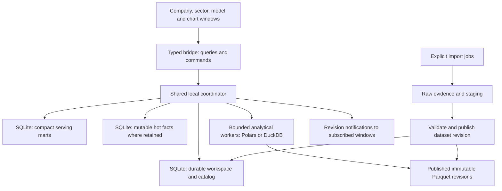

# Local storage for a multi-window analytical workstation

Date: 2026-11-04. Status: research recommendation, not an accepted migration plan.
Repository baseline: `4b2b73cb448c234f3eb234e8300b287a2df26d52`, with existing local skill-installation changes preserved.

## Recommendation

Publication tracking (2026-11-05): [initial desk research #465](https://github.com/joaosantossgp/analysis/issues/465)
records this study under [goal #464](https://github.com/joaosantossgp/analysis/issues/464).
[Planning and validation #466](https://github.com/joaosantossgp/analysis/issues/466)
remain open for product decisions, experiments and implementation planning.
This publication milestone does not establish an approved engine or migration.

Evolve the existing hybrid architecture: SQLite for durable user work, catalog metadata and bounded serving tables; immutable Parquet for large analytical history; a shared local data coordinator for every window. Evaluate DuckDB as the analytical SQL engine over those files against the existing Polars implementation. Do not replace working Polars paths without measured benefit.

For the larger ambition, evaluate DuckLake if snapshot, revision and schema-management requirements outgrow the bounded manifest design. Compare a native DuckDB catalog for one owning process with a SQLite catalog for independently attaching local workers. Adoption requires a Windows packaging, recovery and performance trial. PostgreSQL becomes a conditional option when independent concurrent writers or remote collaboration actually require a server.

The central design decision is ownership of data and publication, not the number of windows. Multiple windows should share one logical data service and dataset revisions. They should not each create an independent ingestion pipeline or mutable copy of the analytical database.

This proposal assumes one analyst, one Windows workstation, local SSD storage and offline access to downloaded data. Bloomberg-like means many coordinated analytical windows; it does not imply a verified Bloomberg internal architecture, exchange connectivity, trading execution or unlimited full-market tick retention. Those would be separate product requirements.

## What exists today

| Verified evidence | Consequence |
|---|---|
| `desktop/app.py:1211` constructs a shared bridge; `:1243` creates Excel Mapping windows and `:1277` creates the main window using that bridge | Multi-window has an implemented starting point; it is not necessary to assume a shell rewrite |
| `apps/desktop-web/src/lib/bridge/adapter.ts:1` centralizes frontend calls | Keep a typed query/command boundary as the backend evolves |
| Accepted [ADR 0007](../decisions/0007-local-analytical-storage.md) requires metadata/marts in SQLite and managed large facts outside main databases | This recommendation extends the existing contract |
| `src/platform/managed_ingestion_contract.py:18` defines lineage; `:83` defines managed paths | Reuse dataset identity, grain, schema version and source lineage |
| `src/energy_kpi/hourly_read_adapter.py:529` and `:571` use Polars lazy Parquet scans | DuckDB is a candidate addition, not the current reader |
| `src/energy_kpi/hourly_store_ingest.py:49` coordinates hot storage, rollover, marts, manifest and catalog updates | A file rename alone does not establish a transaction across those resources; crash consistency needs explicit validation |
| `src/financials/database.py:37` and `src/energy_kpi/schema.py:46` set `synchronous=OFF` in initialization paths | Audit actual connection settings and durability classes before expanding user-authored content |
| `apps/desktop-web/src/lib/indicators/useIndicatorConfig.ts:81` and `apps/desktop-web/src/routes/HomePage.tsx:249` read browser storage | Persisted workspace state needs a deliberate multi-window ownership and backup contract |
| `requirements.txt` declares Polars and pywebview, but not DuckDB | Any engine addition has dependency and packaged-release work |

ADR 0007 records a June migration of 66,719,664 hourly rows, a reduction from about 28.7 GiB to a 5.0 GiB main energy database, and about 4.8 GiB of managed detail. These are historical recorded measurements, not measurements of the current user's installation. The ADR's 12/16/32 GiB budgets are existing product guardrails, not engine capacity limits. Larger ambitions require a separately approved budget revision.

No live database was opened, inventoried, modified or benchmarked for this research. The current bundled SQLite version and runtime PRAGMAs remain **Needs validation**.

## Workload and capacity model

Different workloads need different access patterns:

| Workload | Typical operation | Proposed authoritative storage |
|---|---|---|
| Layouts, watchlists, annotations, model assumptions, thesis revisions | Small transactional edits; restore after crash | SQLite user workspace database |
| Entity identity, provider mapping, ingestion jobs, lineage | Indexed relational reads and short writes | SQLite catalog/domain tables |
| Statements and compact company/sector facts | Entity/period lookup and comparison | Existing SQLite tables and marts; move only measured large analytical portions |
| Multi-sector hourly histories, prices, curves, macro vintages | Column scans, joins, grouped calculations | Versioned Parquet datasets |
| Raw CSV/ZIP/PDF/JSON evidence | Preserve and retrieve exact source bytes | Local immutable source files referenced by catalog |
| Chart previews, screen summaries and search indexes | Small low-latency responses | Rebuildable marts/caches; search index is not source evidence |
| Future live ticks/order-book events | Ordered ingestion, replay, gap detection, sustained writes | Separate capture path, bounded hot segment and immutable historical segments; engine selected by workload trial |

Illustrative scale scenarios below are arithmetic, not forecasts or benchmarks:

- Daily observations: 20,000 instruments × 252 sessions × 20 years = 100.8 million rows.
- Minute observations: 10,000 instruments × 390 minutes × 252 sessions × 10 years = 9.828 billion rows. The 390-minute session is a synthetic sizing assumption, not a B3 calendar contract.
- Event feed: 100,000 events/second × 28,800 seconds = 2.88 billion events/day. At an assumed 64 bytes/event that is 184.32 GB/day before compression, indexes, source retention and backup. Actual order-book payloads and burst rates may differ substantially.

Full tick history therefore needs explicit universe, depth, retention, sampling and disk budgets. A local product can support large selected histories without promising that one laptop stores every market event indefinitely. Capacity planning must include raw evidence + normalized facts + marts + retained revisions + backup + temporary spill + migration headroom; compression ratios must be measured per source.

## Alternatives and decision criteria

These are engineering judgments for this product, not measured rankings. Decision priorities are correctness and recoverability, packaged/offline operation, preservation of existing workflows, then demonstrated analytical benefit and maintenance cost. Existing SQLite/Parquet/Polars remains the baseline until the promotion gates are met. No current cross-dataset SQL bottleneck or excessive manifest-maintenance burden was demonstrated here.

| Option | Best fit | Main cost or limitation | Recommendation |
|---|---|---|---|
| SQLite only | Small transactions and bounded indexed views | Large repeated analytical scans and row/index amplification | Retain for transactional and serving workloads; do not reverse ADR 0007 |
| SQLite + Parquet + current Polars | Existing fixed transforms and bounded detail reads | Custom cross-file publication and analytical query composition | Immediate baseline; improve coordination and measure first |
| SQLite + Parquet + DuckDB | Cross-dataset SQL, joins and broad analytical exploration | New dependency, resource contention, query governance | First SQL candidate to evaluate if the target workflow needs it |
| SQLite user state + DuckLake analytical tables | Revisions, table snapshots, schema evolution, multiple local analytical clients | Extensions, maintenance, operational and recovery qualification | Evaluate if required revision management outgrows bounded manifests |
| Single native DuckDB database for everything | Compact self-contained analytical package | Transactional UI saves and many tiny queries are a different workload; direct file ownership needs discipline | Optional derived cache, not the default universal store |
| Local PostgreSQL plus analytical files | Independent transactional writers and server semantics | Server lifecycle, upgrades, backup, credentials and support in desktop packaging | Conditional escalation, not required by multiple windows alone |
| Dedicated time-series server | Sustained market-event ingestion and specialized time-series queries | Additional service, retention/compaction and integration | Evaluate only against a defined tick/replay workload |

SQLite WAL permits concurrent readers with a writer, but only one active writer per database; long reads can delay checkpoint progress. It is not a shared-network-filesystem deployment model. Keep transactions short and separate interactive work from bulk maintenance. [SQLite WAL](https://www.sqlite.org/wal.html)

DuckDB's direct in-process native-file mode has one read/write owning process; multiple independent read-only processes require no writer. Current 2.0 documentation also describes Quack client/server access, so “DuckDB never supports multiple writer processes” would be inaccurate. This proposal uses broker-owned access and does not depend on Quack. [DuckDB concurrency](https://duckdb.org/docs/2.0/connect/concurrency)

DuckDB supports analytical operators that spill to disk, but some query shapes can still exhaust memory. It is not primarily optimized for many small concurrent requests. That supports keeping hot screen responses in compact read models, with analytical execution subject to scheduling and memory limits. [Workload tuning](https://duckdb.org/docs/2.0/guides/performance/how_to_tune_workloads)

Polars already supports lazy optimization, including predicate and projection pushdown. A new engine must demonstrate benefits for the actual joins, calculations and operational needs, rather than win by being compared against an unoptimized baseline. [Polars optimizations](https://docs.pola.rs/user-guide/lazy/optimizations/)

DuckLake recommends a DuckDB catalog for one local client and SQLite for multiple local clients, with serialized writes and lock retries. Multiple windows behind one owning process do not require the latter. Independently attaching workers may justify it, adding a `sqlite` extension and lock/retry qualification. PostgreSQL is its multi-user/remote option. File merging, snapshot expiration and cleanup remain operational responsibilities. [Catalog selection](https://ducklake.select/docs/stable/duckdb/usage/choosing_a_catalog_database), [maintenance](https://ducklake.select/docs/stable/duckdb/maintenance/recommended_maintenance)

PostgreSQL can operate entirely on the local machine, but remains a client/server system. Major upgrades involve cluster upgrade procedures rather than simply changing an embedded Python package. The operational burden is justified if its concurrency and administration capabilities solve demonstrated needs. [Architecture](https://www.postgresql.org/docs/current/tutorial-arch.html), [upgrades](https://www.postgresql.org/docs/current/upgrading.html)

QuestDB is one concrete candidate for a future tick-ingestion comparison: its WAL supports concurrent ingestion and out-of-order handling. Its OSS backup requires coordinated checkpoint/copy/release, while built-in incremental backup is an Enterprise feature. Qualify acknowledgment durability and edition costs in the trial; no tick throughput benchmark was performed here. [QuestDB WAL](https://questdb.com/docs/concepts/write-ahead-log/), [backup options](https://questdb.com/docs/operations/backup/)

## Proposed multi-window data flow

The coordinator is initially a logical boundary inside the existing Python runtime. Moving analytical workers into supervised processes can improve fault isolation; it does not require moving the UI to Electron, replacing pywebview or exposing a public HTTP service. pywebview supports multiple windows and window-specific Python APIs. [pywebview API](https://pywebview.flowrl.com/api/)

Proposed rules:

1. Every window has `window_id`, `workspace_id`, independent navigation and an optional linked-selection group. Selecting a company in one linked group must not overwrite unrelated windows.
2. Commands go through the coordinator. User edits carry an expected object revision; stale edits return a conflict instead of silently overwriting another window's work.
3. Identical concurrent reads share work. Cache keys include query parameters, dataset revisions and transformation versions. Cancellation is subscriber-aware: closing one window must not cancel work still needed by another.
4. Interactive lookup, analytical exploration, import and export have separate bounded queues. Limit aggregate CPU, memory and spill use across workers; do not allocate the whole machine independently to each window.
5. Return a bounded page, aggregate or chart resolution. Large exports run as jobs and write files directly. A UI row limit alone is insufficient: an upstream sort or aggregation may still scan everything.
6. Publish an invalidation event after a successful commit. Windows re-read the announced revision; events can be coalesced and reconnecting windows reconcile against catalog versions. An event stream alone is not durable truth.
7. Distinguish latest-available analysis from a pinned research snapshot. A screen spanning several datasets receives an explicit revision vector; unrelated sources need not pretend to share a timestamp.

Example proposed response metadata: `request_id`, `dataset_revisions`, `source_as_of`, `retrieved_at`, `calculation_version`, `coverage_status`, `warnings`. Old valid data stays visible as stale when a refresh fails. Offline views never initiate hidden refreshes.

Arrow is a possible batch-transfer representation between analytical workers. Its IPC formats support streams and files; zero-copy benefits depend on the input and consumer. Do not assume Arrow buffers remain zero-copy through pywebview's basic-object bridge. Start with bounded JSON results; add binary transport only after measuring serialization as a bottleneck. [Arrow IPC](https://arrow.apache.org/docs/python/ipc.html), [bridge return types](https://pywebview.flowrl.com/api/)

## Publication, revisions and financial semantics

The baseline retains the mutable hot SQLite layer required by ADR 0007. Current `hourly_store_ingest.py:313` replaces hot monthly rows in place; rollover writes cold partitions and then deletes the corresponding hot rows. Its cold writer can also replace an existing month directory. Therefore the immutable-revision protocol below is a proposed future design, not a description of current snapshot guarantees. Either retain and coordinate the mutable hot path explicitly or qualify a versioned-hot alternative before claiming consistent historical snapshots.

Parquet is the fact-file representation, not the complete transaction protocol. For new immutable managed revisions, use a publication lifecycle such as:

1. Create a unique import ID and write new files under a staging revision. Never modify a published file in place.
2. Validate schema, counts, uniqueness, source hashes, entity mappings, units, financial invariants and coverage. Close file handles before publication.
3. Prepare immutable manifest and mart revision; both identify exactly the source revision they represent. Keep the previous revision reachable.
4. Promote files to final revision paths on the same volume and ensure the required durability operations complete before committing a catalog pointer. A rename is not, by itself, a proof of crash durability on Windows.
5. Commit a short catalog transaction that makes the new revision discoverable. For multiple datasets or marts, publish a compatible revision vector; otherwise keep an old complete combination or explicitly report a pending mart.
6. After commit, notify windows. Recovery reconciles staging files, unpublished completed revisions and committed references. Failed publication must leave the previous revision usable.
7. Garbage collection removes only unreferenced revisions outside retention, after active readers, pinned model runs and backups have released them. Windows open-handle behavior requires explicit testing.

There is no assumed atomic transaction spanning SQLite, multiple Parquet files and another database. WAL transactions across attached SQLite databases also do not provide atomicity across the entire set. Keep user-workspace transactions self-contained and design dataset publication as a recoverable protocol. [SQLite WAL constraints](https://www.sqlite.org/wal.html)

Before implementing this machinery, compare it with DuckLake's provided snapshots and maintenance behavior. Either implementation must pass the same recovery and portability tests. Avoid maintaining two competing analytical catalogs indefinitely. [DuckLake snapshots](https://ducklake.select/docs/stable/duckdb/usage/snapshots)

Proposed data semantics:

- Preserve stable entity and instrument IDs independently of tickers and names; maintain effective-dated mappings and corporate actions.
- Preserve observation/period time, provider publication time when available, ingestion time and revision identity separately. Do not manufacture publication timestamps when unavailable.
- Keep original and revised financial filings; a historical model needs the information available at its chosen as-of date. Record transformations such as accumulated-to-quarterly conversion explicitly.
- Use declared units, currency, scale, report perimeter, source class and missingness status. A dataset snapshot is not sufficient provenance without these semantics.
- Define precision per field. SQLite REAL is approximate; exact monetary quantities may need scaled integers or a validated decimal representation. DuckDB DECIMAL supports fixed-point arithmetic, but division can produce floating-point values. Do not blindly cast existing financial values or select one precision for all ratios and quantities. [SQLite numeric representation](https://www.sqlite.org/floatingpoint.html), [DuckDB numeric types](https://duckdb.org/docs/2.0/sql/data_types/numeric)
- For tick data, define exchange sequence, event time, receive time, corrections, gaps, replay and duplicate policy before choosing an engine. Separate lossless capture requirements from throttled screen updates.

Partition large facts first by dataset and time at a measured grain; sort within files for dominant entity/time filters. Avoid one tiny file per instrument/day by default. Compare file size, row-group size and pruning using actual schemas and distributions. [Parquet tuning](https://duckdb.org/docs/2.0/data/parquet/tips)

## Durability, portability and maintenance

User assumptions and thesis text are not rebuildable caches. Proposed default for their SQLite transactions is WAL with `synchronous=FULL`, verified on each relevant connection. Rebuildable marts may use a different documented durability policy. SQLite documents loss of recent transactions with WAL/NORMAL on power failure and possible corruption with OFF on operating-system failure or power loss. The observed initialization settings are a concrete audit priority, not proof of damage or of every live connection's setting. [SQLite synchronous](https://www.sqlite.org/pragma.html#pragma_synchronous)

Verify the actual SQLite library inside the packaged executable. Current official documentation identifies a rare concurrent WAL reset defect fixed in 3.51.3, with listed backports 3.44.6 and 3.50.7. Do not infer the bundled library version from Python's version or this research machine. [WAL reset fix](https://www.sqlite.org/wal.html#walresetbug)

Backup must capture every authoritative mutable store, including hot SQLite facts, plus the catalog/workspace and referenced files/raw evidence. SQLite's online backup API snapshots one database; it does not coordinate the entire application. In the current design, quiesce hot writes, hot-to-cold rollover, cold-directory replacement and relevant catalog/mart mutations while acquiring a consistent backup set; suspending only catalog publication is insufficient. In a future immutable design, pin the revision vector and its artifacts until backup completes. Test restore into a different root with a clean packaged app, including a source revision and hot-to-cold rollover boundary. [SQLite backup API](https://www.sqlite.org/backup.html)

Keep active databases on a local filesystem. Recommend exporting completed backup bundles to synchronization folders instead of treating cloud file sync as database replication. Inspect whether the user's Documents path is redirected before moving anything; this research does not change the existing data-root contract.

Use portable dataset-relative paths in manifests where possible, with controlled root resolution. Pin engine and extension versions in releases; required extensions must be packaged and tested with networking disabled, not downloaded on the first offline analytical query. DuckDB has an installable extension system, so dependency availability belongs in the release test. Add storage diagnostics for source bytes, normalized bytes, mart bytes, WAL, spill, retained revisions and backup space. [DuckDB extensions](https://duckdb.org/docs/2.0/extensions/overview)

User notes, imported private files and credentials need separate access rules. Store secrets through an OS-backed mechanism rather than a general dataset catalog. Choose encryption and recovery-key policy from the product's confidentiality requirements; encryption does not substitute for backup.

## Validation plan and promotion gates

No benchmark results are claimed. The next experiment should compare three bounded implementations on copied data: current SQLite/marts + Polars; identical Parquet with DuckDB; and DuckLake for revision/publication behavior. Use the same filters, financial semantics and result checks. Add local PostgreSQL only if the experiment demonstrates a transactional writer bottleneck.

| Dimension | Proposed cases and evidence |
|---|---|
| Hardware | Document CPU, RAM, SSD, free space, OS and engine versions; test representative 16 GB and 32 GB Windows machines |
| Data | Existing copied energy/financial fixtures, then labeled synthetic 100M and 1B-row datasets if disk budgets permit; preserve distributions and skew |
| Windows | 1, 4 and 12 windows; repeated same query and distinct queries; link-group selection bursts |
| Reads | Company statement lookup, sector comparison, entity/hour drill-down, multi-domain join, model calculation, chart downsampling |
| Contention | Reads during refresh, source revision, mart rebuild, large export and checkpoint; test cold and warm cache separately |
| Measurements | End-to-end p50/p95/p99, queue wait, DB time, serialization, rendering, rows/bytes scanned, RSS, CPU, spill, WAL, disk amplification and cancellation latency |
| Correctness | Result equivalence with null/unit/perimeter semantics, no duplicate facts, no mixed revisions, reproducible model/export hashes or documented numeric tolerances |
| Recovery | Inject termination before/after publication steps, disk-full, held file handles, corrupt/missing artifact, duplicate batch, retry and stale manifest; restore hot/cold rollover and revised-month backups |
| Deployment | Packaged clean install, offline first use, non-ASCII path, different drive/root, update/rollback and fresh-machine restore |

Provisional product targets to discuss: p95 below 200 ms for compact local metadata requests; below one second for bounded chart data; immediate progress/cancellation feedback for long jobs; no lost acknowledged user edits within the declared durability model. These are suggested acceptance goals, not measured performance or guarantees. Process termination tests do not prove power-loss durability.

Adopt DuckDB only if useful analytical workloads improve enough to justify dependency/support cost without regressing interactive responsiveness. Adopt DuckLake if its revision/schema/maintenance facilities outperform a small custom catalog in reliability and implementation burden. Escalate to PostgreSQL if sustained independent writes cannot meet agreed latency after short transactions and scheduling. Consider a dedicated tick engine only with an explicit throughput, replay and retention contract.

## Suggested sequence

1. Record workload, retention, hardware and latency targets; inspect packaged versions, effective PRAGMAs and real data sizes without changing data.
2. Define shared window/workspace identity, query budgets, revision metadata and durable user-state ownership; reuse the existing bridge.
3. Benchmark Polars versus DuckDB on one real cross-dataset analytical workflow and test a DuckLake snapshot/recovery slice on copies.
4. Choose the analytical catalog/engine from evidence, then write a new ADR or explicit extension to ADR 0007 and create scoped implementation issues.
5. Migrate one dataset with backup, dual-read equality checks, rollback and a packaged offline smoke test. Expand only after acceptance.

This research changes no application behavior, dependency, schema, runtime data or accepted ADR. Full-market event capture, trading execution and remote multi-user operation remain conditional scenarios, not implied implementation commitments.
